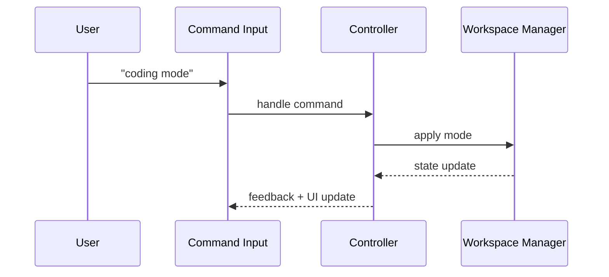
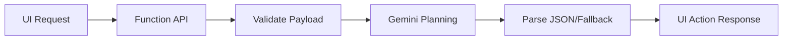

# Etherea — Your Living Adaptive OS 🌌✨ (v3.0.999)

<p align="center">
  
  
  
</p>

> [!IMPORTANT]
> **Canonical behavior reference:** `ETHEREA_CORE.md`  
> **Primary runtime entrypoint:** `python main.py`

Etherea is a desktop-first adaptive environment that combines avatar-led interaction, workspace routing, and focus-aware behavior into a single demo-ready operating experience.

---

## Product Introduction

Etherea Adaptive OS v3 is built around three goals:
- Keep interaction **human-facing and expressive** (avatar + aurora style UI).
- Keep workflows **predictable and mode-driven** (study/coding/exam/calm/deep-work).
- Keep execution **resilient** with local-first runtime and optional cloud extensions.

This repository currently contains:
- **Desktop runtime** (Python + PySide6) under `corund/`.
- **Web frontend track** (Vite + React) under `frontend/`.
- **Firebase integration track** under `functions/` + `firebase.json`.
- **Testing/doctor scripts** under `tests/` and `scripts/`.

---

## What Exists in This Repo (Ground Truth)

### Core Runtime
- `main.py` bootstraps the desktop app via `AppController`.
- `etherea_launcher.py` provides HiDPI-safe launch behavior and safe-mode/self-test flags.
- `corund/ui/main_window_v3.py` is the active window implementation path in the runtime.

### Operational Files
- `SETUP.md` for environment setup.
- `ETHEREA_CORE.md` for behavior truth mapping.
- `docs/firebase_production_deploy.md` and `tools/firebase_deploy.sh` for deployment flow.
- `Makefile` shortcuts to `scripts/etherea-doctor`.

### Cloud / Web Track
- `frontend/` uses Vite (`npm run dev`, `npm run build`).
- `functions/` runs Node 20 Firebase Functions.
- `firebase.json` is configured for hosting (`frontend/dist`) and SPA rewrites.

---

## Install & Run

### Desktop Development Setup (recommended)

Follow `SETUP.md` directly. Quick path:

```bash
python3.11 -m venv .venv
source .venv/bin/activate
python -m pip install --upgrade pip
pip install -r requirements-desktop.txt
python main.py
```

Windows PowerShell equivalent:

```powershell
py -3.11 -m venv .venv
.\.venv\Scripts\Activate.ps1
python -m pip install --upgrade pip
pip install -r requirements-desktop.txt
python main.py
```

### Alternative Entrypoints

```bash
python etherea_launcher.py
python etherea_workspace_cli.py
python server.py
```

---

## Demo / Command Layer

Typical presenter commands supported by the current flow:
- `present on` / `present off`
- `co-present` / `next` / `skip`
- `dance` / `hum` / `surprise`
- `study mode` / `coding mode` / `exam mode` / `calm mode`
- `save session` / `continue last session`

> [!TIP]
> For examination/demo runs, use `etherea_launcher.py` when display scaling or environment consistency is a concern.

---

## Architecture (Mermaid)

### System Overview

```mermaid
flowchart TD
  U[User] --> UI[PySide6 Desktop UI]
  UI --> AC[AppController]
  AC --> WC[Workspace Controller]
  WC --> WM[Workspace Manager]
  WC --> AIR[Workspace AI Router]

  UI --> AV[Avatar / Visual Layer]
  UI --> AU[Audio / Voice Layer]
  WM --> MEM[Session Memory]
  AC --> SAFE[Diagnostics + Recovery]

  AIR --> FNS[Firebase Functions (optional)]
  FNS --> UI
```

### Command Flow



### Cloud Assist Path (Optional)



---

## Diagnostics & Quality Checks

### Doctor

```bash
./scripts/etherea-doctor
```

### Compile sanity

```bash
python -m compileall corund tests functions
```

### Optional safety check

```bash
python etherea_safe_check.py | tee safe_check_report.txt
```

---

## Firebase / Web Deployment Track

### Manual Commands

```bash
npm install -g firebase-tools
firebase login
export FIREBASE_PROJECT_ID=<your-project-id>
firebase use "$FIREBASE_PROJECT_ID" --add
firebase functions:secrets:set GEMINI_API_KEY --project "$FIREBASE_PROJECT_ID"
cd frontend && npm ci && npm run build && cd ..
firebase deploy --project "$FIREBASE_PROJECT_ID"
```

### Scripted Path

```bash
./tools/firebase_deploy.sh
```

---

## Documentation Map

- `ETHEREA_CORE.md` — canonical behavior and command truth
- `SETUP.md` — desktop/dev setup
- `docs/firebase_production_deploy.md` — production deployment guide
- `docs/RELEASE.md` — release process notes
- `docs/final_merge_gate.md` — merge/release gating
- `docs/packaging_checklist.md` — packaging checklist

---

## About

Etherea is a living adaptive OS prototype focused on guided interaction, expressive system feedback, and practical demo reliability.

---

## Contributors

### Team Structure

- **Brunda G** — Core coordination, logic flow, real frontend and backend logic creation, planner workflows.
- **Chandramma** — Database management exclusively for Etherea and `data/*.md` content creation.
- **Chinmai HA** — Database management assistance and brain-integration support.
- **Ayathunnisa** — Creative head and design logic.
- **Arshiya Khanum** — Debugging and testing workflows.
- **Azra Rahman** — Hardware and software analysis.
- **ChatGPT** — Documentation and planning assistance.
- **Google Antigravity** — Agentic assistance.
- **Codex** — Deep agentic assistance and implementation support.
- **Gemini** — Brain-support and agentic intelligence assistance.

### Academic Guidance

- **Mrs. Radhika S N** — Assistant Professor, Department of CS&E (Guide).

---

## License & Usage

If packaging or redistributing Etherea variants, align with repository policies and operational constraints documented in `docs/`.
