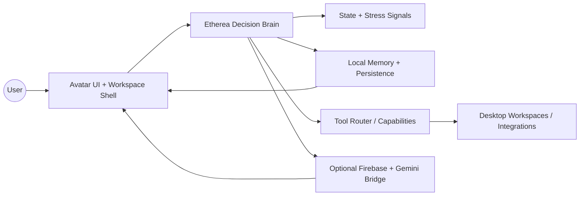
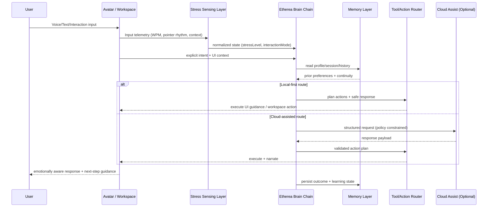
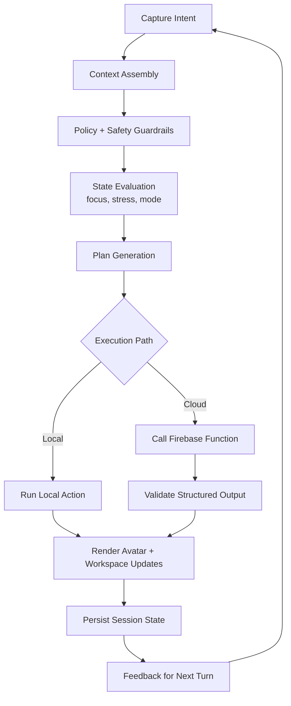

# Etherea Adaptive OS v3

Etherea is an **emotionally intelligent companion OS experience** that blends a cinematic avatar interface, adaptive workspace orchestration, and privacy-aware local intelligence.  
It includes a flagship desktop runtime (PySide6) plus web/Firebase deployment tracks for demo and cloud-assisted workflows.

---

## Product Introduction

**Etherea Adaptive OS v3** is designed as a companion computing layer that helps users stay focused, calm, and effective while working.

Core outcomes:
- Adaptive interaction: voice + text + teaching flows.
- Emotional context signals (e.g., stress/focus) used to tune pacing and assistance.
- Privacy-first behavior with resilient local fallback modes.
- Avatar-led UX for guidance, explanations, and onboarding.

---

## What Exactly Is the Product?

### Canonical Product (Primary)
- **Desktop application** built with **PySide6**.
- Entry points:
  - `python main.py`
  - `python etherea_launcher.py`
- Main window implementation: `corund/ui/main_window_v3.py`.

### Companion Tracks (Secondary)
- `frontend/`: Vite + React experience (Firebase Hosting target).
- `functions/`: Firebase Cloud Functions backend integration.
- `etherea-webos/`: Extended web/desktop/android prototype track.

> If you are evaluating “the core Etherea product,” use the **desktop runtime first**.

---

## High-Level Architecture



---

## Etherea “Aetheria Chain Link” Workflow

This diagram shows how user intent, sensing, memory, and the “brain chain” collaborate.



---

## “Brain Works” Pipeline (Decision Loop)



---

## Repository Map

```text
.
├── corund/                  # Core desktop runtime logic (primary product)
├── frontend/                # Vite + React frontend deployment target
├── functions/               # Firebase Cloud Functions backend
├── etherea-webos/           # Multi-platform prototype track
├── docs/                    # Product docs, reports, deployment notes
├── scripts/                 # Tooling, validation, utility scripts
├── tests/                   # Python test suite
├── firebase.json            # Hosting + Functions config
└── README.md
```

---

## Quick Start

### 1) Desktop (Recommended First)

```bash
python main.py
```

Alternative launcher:

```bash
python etherea_launcher.py
```

### 2) Python Test/Health Check

```bash
./scripts/etherea-doctor
```

---

## Firebase / Web Deployment Track

For production deployment steps, use:
- `docs/firebase_production_deploy.md`
- `tools/firebase_deploy.sh`

Canonical command flow:

```bash
npm install -g firebase-tools
firebase login
firebase use <your-project-id> --add
firebase functions:secrets:set GEMINI_API_KEY --project <your-project-id>
cd frontend && npm ci && npm run build && cd ..
firebase deploy --project <your-project-id>
```

---

## Security, Privacy, and Reliability Principles

- Local-first behavior with graceful degradation paths.
- Sensitive keys handled via Firebase Secret Manager (not committed to repo).
- Guardrails for unsafe or malformed responses.
- Fallback behavior when optional UI/runtime dependencies are unavailable.

---

## Asset Policy

- No AI agent should generate or commit arbitrary binary assets.
- Assets are curated and must include safe runtime fallback behavior.

---

## Contributors

> Contributors section will be expanded with your exact names/roles in the next pass.

Current maintainership signal:
- Etherea core direction by **Bru and the Etherea team**.

---

## License & Usage

If you are packaging or redistributing Etherea variants, align with repository policy and deployment constraints documented in `docs/`.

