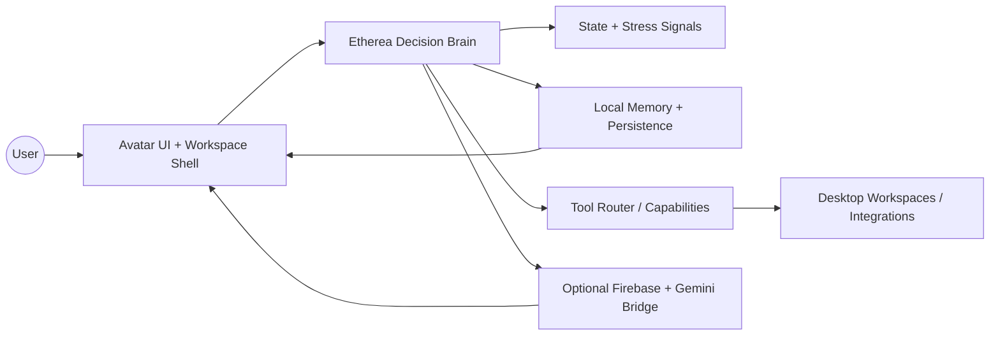
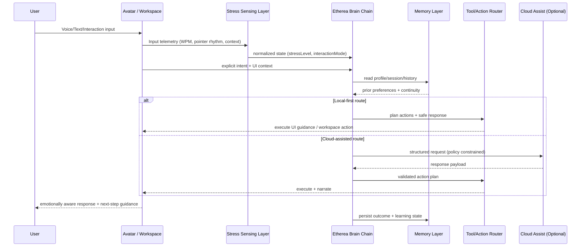
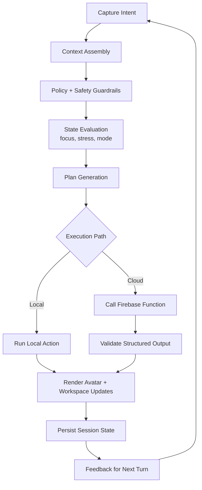

# Etherea Adaptive OS v3

Etherea is an **emotionally intelligent companion OS experience** that blends a cinematic avatar interface, adaptive workspace orchestration, and privacy-aware local intelligence.  
It includes a flagship desktop runtime (PySide6) plus web/Firebase deployment tracks for demo and cloud-assisted workflows.

---

## Product Introduction

**Etherea Adaptive OS v3** is designed as a companion computing layer that helps users stay focused, calm, and effective while working.

Core outcomes:
- Adaptive interaction: voice + text + teaching flows.
- Emotional context signals (e.g., stress/focus) used to tune pacing and assistance.
- Privacy-first behavior with resilient local fallback modes.
- Avatar-led UX for guidance, explanations, and onboarding.

---

## What Exactly Is the Product?

### Canonical Product (Primary)
- **Desktop application** built with **PySide6**.
- Entry points:
  - `python main.py`
  - `python etherea_launcher.py`
- Main window implementation: `corund/ui/main_window_v3.py`.

### Companion Tracks (Secondary)
- `frontend/`: Vite + React experience (Firebase Hosting target).
- `functions/`: Firebase Cloud Functions backend integration.
- `etherea-webos/`: Extended web/desktop/android prototype track.

> If you are evaluating “the core Etherea product,” use the **desktop runtime first**.

---

## High-Level Architecture



---

## Etherea “Aetheria Chain Link” Workflow

This diagram shows how user intent, sensing, memory, and the “brain chain” collaborate.



---

## “Brain Works” Pipeline (Decision Loop)



---

## Repository Map

```text
.
├── corund/                  # Core desktop runtime logic (primary product)
├── frontend/                # Vite + React frontend deployment target
├── functions/               # Firebase Cloud Functions backend
├── etherea-webos/           # Multi-platform prototype track
├── docs/                    # Product docs, reports, deployment notes
├── scripts/                 # Tooling, validation, utility scripts
├── tests/                   # Python test suite
├── firebase.json            # Hosting + Functions config
└── README.md
```

---

## Quick Start

### 1) Desktop (Recommended First)

```bash
python main.py
```

Alternative launcher:

```bash
python etherea_launcher.py
```

### 2) Python Test/Health Check

```bash
./scripts/etherea-doctor
```

---

## Firebase / Web Deployment Track

For production deployment steps, use:
- `docs/firebase_production_deploy.md`
- `tools/firebase_deploy.sh`

Canonical command flow:

```bash
npm install -g firebase-tools
firebase login
firebase use <your-project-id> --add
firebase functions:secrets:set GEMINI_API_KEY --project <your-project-id>
cd frontend && npm ci && npm run build && cd ..
firebase deploy --project <your-project-id>
```

---

## Security, Privacy, and Reliability Principles

- Local-first behavior with graceful degradation paths.
- Sensitive keys handled via Firebase Secret Manager (not committed to repo).
- Guardrails for unsafe or malformed responses.
- Fallback behavior when optional UI/runtime dependencies are unavailable.

---

## Asset Policy

- No AI agent should generate or commit arbitrary binary assets.
- Assets are curated and must include safe runtime fallback behavior.

---

## Contributors

### Team Structure

| Name | Responsibility |
|---|---|
| Brunda G | System architecture, GitHub organization, module dependency planning, coding standards, integration coordination |
| Chandramma | Documentation and self-awareness integration |
| Chandra | Client development support |
| Ayathunnisa | Design systems, lab setup, and creative production support |
| Azra Rahman | Cross-module implementation support and feature collaboration |
| Chinmai HA | Runtime feature support and implementation collaboration |
| Asad Ahmed | Hardware/software alignment and mobile analysis |
| Arshiya Khanum | Debugging, QA validation, and testing workflows |

### Academic Guidance

| Name | Role |
|---|---|
| Mrs. Radhika S N | Assistant Professor, Department of CS&E (Guide) |

### Contributor Notes
- Contributions are organized by delivery area and integration ownership.
- Documentation, testing, runtime features, and deployment support are all tracked as first-class contributions.
- Team member responsibilities can be updated as modules evolve.

---

## Release Documentation

For release-critical operations and deployment workflows, see:
- `docs/firebase_production_deploy.md`
- `docs/RELEASE.md`
- `docs/final_merge_gate.md`
- `docs/packaging_checklist.md`

---

## Etherea “Aetheria Chain Link” Workflow

This diagram shows how user intent, sensing, memory, and the “brain chain” collaborate.


---

## “Brain Works” Pipeline (Decision Loop)


---

## Repository Map

```text
.
├── corund/                  # Core desktop runtime logic (primary product)
├── frontend/                # Vite + React frontend deployment target
├── functions/               # Firebase Cloud Functions backend
├── etherea-webos/           # Multi-platform prototype track
├── docs/                    # Product docs, reports, deployment notes
├── scripts/                 # Tooling, validation, utility scripts
├── tests/                   # Python test suite
├── firebase.json            # Hosting + Functions config
└── README.md
```

---

## Quick Start

### 1) Desktop (Recommended First)

```bash
python main.py
```

Alternative launcher:

```bash
python etherea_launcher.py
```

### 2) Python Test/Health Check

```bash
./scripts/etherea-doctor
```

---

## Firebase / Web Deployment Track

For production deployment steps, use:
- `docs/firebase_production_deploy.md`
- `tools/firebase_deploy.sh`

Canonical command flow:

```bash
npm install -g firebase-tools
firebase login
firebase use <your-project-id> --add
firebase functions:secrets:set GEMINI_API_KEY --project <your-project-id>
cd frontend && npm ci && npm run build && cd ..
firebase deploy --project <your-project-id>
```

---

## Security, Privacy, and Reliability Principles

- Local-first behavior with graceful degradation paths.
- Sensitive keys handled via Firebase Secret Manager (not committed to repo).
- Guardrails for unsafe or malformed responses.
- Fallback behavior when optional UI/runtime dependencies are unavailable.

---

## Asset Policy

- No AI agent should generate or commit arbitrary binary assets.
- Assets are curated and must include safe runtime fallback behavior.

---

## Contributors

Etherea is developed by a cross-functional team spanning product strategy, systems engineering, AI behavior design, and deployment operations.

### Maintainers
- **Bru and the Etherea team** — Product direction, architecture ownership, release stewardship.

### Contributor Matrix

| Track | Responsibilities | Typical Outputs |
|---|---|---|
| Product & Experience | Interaction model, teaching flow, avatar UX, narrative quality | UX specs, behavior prompts, journey maps |
| Core Runtime (Desktop) | PySide6 app architecture, orchestration, state integrity, performance | Runtime features, stability fixes, integration adapters |
| Frontend / Web | Vite + React interfaces, command surfaces, deployment-ready UX | UI components, state hooks, web release bundles |
| Cloud & DevOps | Firebase hosting/functions, secrets handling, release pipelines | Deploy scripts, infra config, production checks |
| Quality & Verification | Test planning, smoke coverage, regression gates, merge checks | Test suites, CI checks, verification reports |
| Docs & Enablement | Architecture docs, setup runbooks, release notes, onboarding | README updates, deployment guides, checklists |

### Named Contributors (to be finalized)

Add contributor entries with this format (maintainers will publish canonical order):
Etherea is built by a multidisciplinary team across product design, systems engineering, AI behavior design, and deployment operations.

### Core Maintainers
- **Bru and the Etherea team** — Core product direction, architecture, and delivery stewardship.

### Contributor Roles (v3)
- **Product & Experience**: vision, interaction model, avatar behavior, narrative UX.
- **Core Systems**: desktop runtime, orchestration, state model, performance hardening.
- **Frontend/Web**: Vite/React UI, workspace flows, deployment-facing interfaces.
- **Cloud & DevOps**: Firebase Hosting/Functions, release pipelines, production rollout safety.
- **Quality & Validation**: test strategy, smoke checks, regression gates, release readiness.
- **Documentation**: architecture maps, runbooks, onboarding, release notes.

### How to Add Yourself (Contributors Registry)
Until a dedicated contributors file is introduced, add your contributor details in PR descriptions using this format:

```text
Name:
Role:
Tracks:
GitHub / Portfolio:
Primary Contributions:
```

### Contribution Standards
- Keep changes aligned with Etherea’s local-first, privacy-aware mission.
- Prefer focused, reviewable PRs with explicit validation commands.
- Include migration/rollback notes for infra or runtime-impacting changes.
- Avoid changing canonical desktop behavior without release-note coverage.

### Acknowledgements
- Open-source ecosystems: Python, Qt/PySide6, React, Vite, Firebase, and testing toolchains.
- Early reviewers and users contributing continuous product feedback.
Area(s):
GitHub/Portfolio:
Key Contributions:
```

### Contribution Principles
- Keep changes aligned with Etherea’s local-first and privacy-aware mission.
- Prefer small, reviewable PRs with explicit validation steps.
- Include rollback notes for infrastructure-impacting changes.
- Avoid breaking canonical desktop runtime behavior unless explicitly planned.

### Acknowledgements
- Open-source communities powering Python, Qt/PySide6, React, Vite, Firebase, and testing ecosystems.
- Early users and reviewers who continuously shape Etherea usability and safety.

---

## Release Documentation

For release-critical operations and deployment workflows, see:
- `docs/firebase_production_deploy.md`
- `docs/RELEASE.md`
- `docs/final_merge_gate.md`
- `docs/packaging_checklist.md`

For release-critical operations and deployment workflows, see:
- `docs/firebase_production_deploy.md`
- `docs/RELEASE.md`
- `docs/final_merge_gate.md`
- `docs/packaging_checklist.md`

> Contributors section will be expanded with your exact names/roles in the next pass.

Current maintainership signal:
- Etherea core direction by **Bru and the Etherea team**.

---

## License & Usage

If you are packaging or redistributing Etherea variants, align with repository policy and deployment constraints documented in `docs/`.

