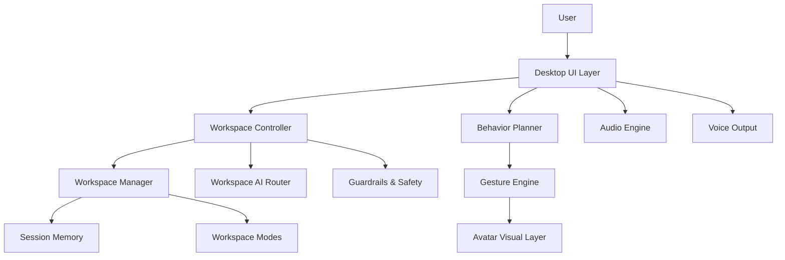
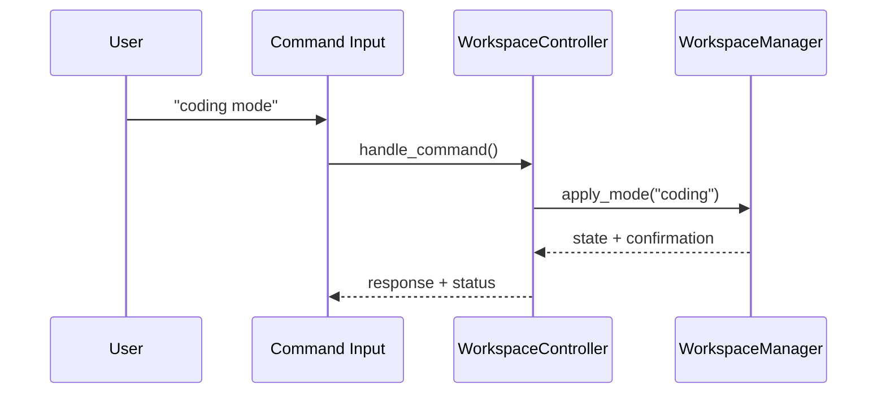
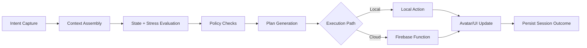

# Etherea — Your Living Adaptive OS 🌌✨ (v3.0.999)

Etherea is a desktop-first adaptive environment designed to feel alive, expressive, and context-aware.
It combines a heroine-avatar interface, workspace orchestration, and guided presentation flows for demos and real usage.

**Canonical build behavior reference:** `ETHEREA_CORE.md`

---

## Product Introduction

Etherea Adaptive OS v3 focuses on:
- emotionally aware interaction layers,
- adaptive workspace routing,
- cinematic avatar feedback,
- local-first reliability with optional cloud integrations.

This repository includes:
- a **primary desktop runtime** (PySide6),
- a **web/Firebase track** for deployment experiments,
- supporting docs, diagnostics, and CI utilities.

---

## What’s New (v3.0.999)

This release is the report-aligned demo build focused on:
- **Presenter Mode** with gentle “alive” ambient motion,
- **Co-present flow** (short demo-safe companion lines),
- **Demo expressives**: `dance`, `hum`, `surprise`,
- **FocusGuardian** nudges during strict focus sessions,
- **Release-focused CI execution** for cleaner release workflows.

---

## Status (Reality Check)

### Working
- Desktop PySide6 UI with heroine/avatar command interactions.
- Presenter/demo command layer.
- Workspace routing + session continuity logic.
- Audio/voice output adapters (optional dependency based).

### Partially Working / Optional
- HID and EI signals (OS dependency sensitive).
- Voice input path (mic/system dependency sensitive).
- Mock Flask web server (`server.py`) for simulation/testing.

### Planned / Conceptual
- Some docs describe broader roadmap ideas and visual specs that are not guaranteed to be fully implemented in current runtime.

---

## Install & Run

### Windows (Release ZIP)
1. Download from the project release page.
2. Extract the ZIP.
3. Run the executable.
4. If SmartScreen appears for unsigned academic builds: **More info → Run anyway**.

### Linux (AppImage)
1. Download the AppImage release artifact.
2. Make it executable:

```bash
chmod +x EthereaOS_Linux.AppImage
```

3. Run:

```bash
./EthereaOS_Linux.AppImage
```

### Local Python (Development)

```bash
python -m venv .venv
source .venv/bin/activate   # Windows: .venv\Scripts\activate
pip install -r requirements-core.txt
python main.py
```

Optional entry points:

```bash
python etherea_launcher.py
python etherea_workspace_cli.py
python server.py
```

---

## Quick Demo Commands

### Presenter Layer
- `present on`
- `present off`
- `co-present`
- `next`
- `skip`

### Expressive Layer
- `dance`
- `hum`
- `surprise`

### Workspace Layer
- `study mode`
- `coding mode`
- `exam mode`
- `calm mode`
- `save session`
- `continue last session`
- `focus 25 minutes`

---

## Documentation Map

- `ETHEREA_CORE.md`: canonical behavior and command truth.
- `README.md`: current release overview and run steps.
- `docs/`: architecture, policies, reports, and release notes.
- `docs/firebase_production_deploy.md`: Firebase production deployment flow.

---

## Architecture (Mermaid)

### System Overview



### Workspace Command Flow



### Brain Decision Loop



---

## Diagnostics (CLI Safe Mode)

Health report:

```bash
python etherea_safe_check.py | tee safe_check_report.txt
```

Compile check:

```bash
python -m compileall corund | tee compile_report.txt
```

Minimal smoke harness:

```bash
python -m compileall corund
python etherea_safe_check.py
python etherea_workspace_cli.py
```

---

## Contributors

### Team Structure

| Name | Responsibility |
|---|---|
| Brunda G | System architecture, GitHub organization, module dependency planning, coding standards, integration coordination |
| Chandramma | Documentation and self-awareness integration |
| Chandra | Client development support |
| Ayathunnisa | Design systems, lab setup, and creative production support |
| Azra Rahman | Cross-module implementation support and feature collaboration |
| Chinmai HA | Runtime feature support and implementation collaboration |
| Asad Ahmed | Hardware/software alignment and mobile analysis |
| Arshiya Khanum | Debugging, QA validation, and testing workflows |

### Academic Guidance

| Name | Role |
|---|---|
| Mrs. Radhika S N | Assistant Professor, Department of CS&E (Guide) |

---

## Release & CI Notes

Release workflows and packaging references:
- `docs/RELEASE.md`
- `docs/final_merge_gate.md`
- `docs/packaging_checklist.md`
- `docs/firebase_production_deploy.md`

---

## Firebase / Web Deployment Track

```bash
npm install -g firebase-tools
firebase login
firebase use <your-project-id> --add
firebase functions:secrets:set GEMINI_API_KEY --project <your-project-id>
cd frontend && npm ci && npm run build && cd ..
firebase deploy --project <your-project-id>
```

Automation helper:

```bash
./tools/firebase_deploy.sh
```

---

## License & Usage

If packaging or redistributing Etherea variants, align with repository policies and operational constraints documented under `docs/`.
